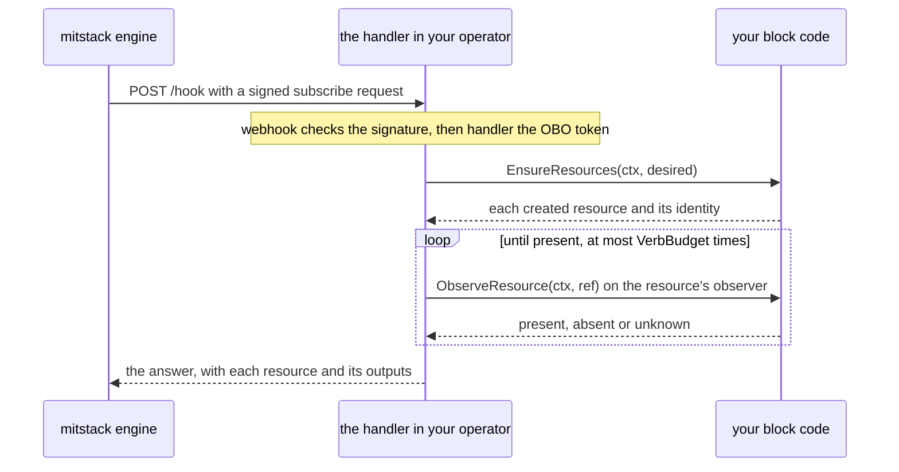

# block-kit

block-kit is the Go module you write a mitstack block's operator with. This
page is for a developer building a first block. It explains what a block and
its operator are, follows one lifecycle call into your code, names the
packages every block imports and the optional ones, and ends with a block to
copy. Its commands name v0.4.0, the first release under the name block-kit.

## What a block and its operator are

mitstack is a platform that runs managed services for apps. A block is one such
service, described by the `manifest.yaml` file in the block's repository. The
manifest names the block, its version and the resources it creates. A resource
is one object at a provider, such as a firewall in a Hetzner Cloud project.
Each resource has a resource type (the exact sort of object it is, written
`<capability>.<name>`, where the capability names the provider, as in
`hetzner.firewall`).

An app uses a block through a subscription. The engine, the part of mitstack
that drives every subscription, sends the block four lifecycle calls over
HTTPS. `subscribe` creates the resources for a new subscription, `upgrade`
brings them to a new version of the block, `validate` reports whether each
resource stands and changes nothing, and `unsubscribe` deletes them. The
operator is the program you write with this kit to answer those calls, a small
HTTP server shipped as a container image.

## How one lifecycle call reaches your code

Your code implements `handler.Resource`, an interface of three methods,
`Ensure`, `Observe` and `Delete`, and you give `handler.New` one observer for
each resource. `handler.New` returns the HTTP handler your operator serves.
The engine signs every call with mitstack's private key and posts it to your
manifest's endpoint, the handler's `/hook` route:



1. The handler first runs the `webhook` package's checks, which verify the
   `X-Mitstack-Signature-Ed25519` header with mitstack's keys from the JWKS
   URL you configure. They answer 401, before your code runs, to a bad
   signature, a reused nonce or a request over five minutes from your clock.
2. The handler decodes the body into a `contract.Request` and checks its OBO
   (on-behalf-of) token, which mitstack signs with the same keys and which
   must name your manifest's `metadata.id` and the request's org, app and
   subscription. Your code receives the request as a `contract.Desired`: the
   subscription, its settings, the provider credentials the request carries,
   and each resource the engine recorded with the identity it was created with.
3. On `subscribe` and `upgrade`, the handler calls your `Ensure`, which creates
   whatever is missing. When your code also has `EnsureResources`, as the
   example below does, the handler calls that instead, since it also returns
   each resource's identity, such as its id at the provider.
4. The handler then waits for the call to settle, which means it asks each
   resource's observer until the provider shows the state the call asked for,
   at most `VerbBudget` times, a `handler.Config` field that defaults to 20.
   An observer implements `handler.Observer` in place of your `Observe`: its
   `ObserveResource(ctx, ref)` reads the resource's name, type and identity
   from `ref`, and answers present with its outputs, absent or unknown.
5. The handler answers with each resource's state and its outputs, the values
   such as an address that the rest of the app may read. An unsettled call
   answers that it is still pending, and the engine asks again later. The
   handler also sends the engine an event saying how the call ended.

| Call | What the handler calls on your code once the checks pass |
|---|---|
| `subscribe`, `upgrade` | `EnsureResources` or `Ensure`, then each resource's observer until it reports present |
| `unsubscribe` | `Delete`, then each resource's observer until it reports absent |
| `validate` | Each resource's observer, once |

## What a block imports

Every block imports the four packages at the root of this repository, and its
tests import `verify/kittest`. blockverify, the check every block must pass
before its image ships, needs both. Everything else is optional: `helpers`
holds helpers tied to no provider and `capabilities` one folder per provider,
and you add a package when your block needs what it does:

| Package | Who imports it | What it gives you |
|---|---|---|
| `contract` | Every block | The request and answer types, such as `contract.Desired` and `contract.Observation`, and the manifest parser |
| `handler` | Every block | `handler.New`, which serves the lifecycle calls over your code |
| `observe` | Every block | Observers for common resource types, such as `observe.HetznerFirewall`, and `observe.Tagged`, the type in which your tests list each object at the provider that carries the subscription's id |
| `webhook` | Every block | The signature checks the handler runs, and `webhook.LogBuffer`, the recent log lines the platform reads at your operator's `/logs` route |
| `verify/kittest` | Every block's tests | The checks blockverify requires your tests to run |
| `helpers/safe` | A block that logs a request's values, or calls an API at an address a request supplies | Secret scrubbing for logs, and an allowlist of the hosts the operator trusts, so a request cannot redirect a call |
| `helpers/events` | A block that reports its own progress or calls the mitstack API during a call | Progress events of its own, and the mitstack API's address and token, taken from the request |
| `helpers/credrefresh` | A block whose short-lived credential must outlive one call | A cache that renews a credential before it expires |
| `helpers/hostexec` | A block that runs a shell script on a server | One script run over AWS Systems Manager or SSH |
| `helpers/reach` | A block that serves an app at a URL | A probe that records whether the app answers |
| `capabilities/aws/cloudid` | A block whose resources live in the org's AWS account | Short-lived AWS credentials from the role and token the request carries for that account |
| `capabilities/github/ghapi` | A block that calls the GitHub API | A GitHub REST client whose host the operator decides |
| `capabilities/github/gitops` | A block that deploys to Kubernetes through Argo CD | Commits the block's files to a GitOps repository and judges the deploy, with test fakes in `capabilities/github/gitops/gitopstest` |

## A minimal block to copy

[`examples/hetzner-firewall`](examples/hetzner-firewall) is a complete block
that keeps one empty Hetzner Cloud firewall for each subscription, the
simplest resource a provider offers for free. Each request carries the org's
credentials for the providers the block works with, such as its Hetzner API
token, in `Desired.Secrets`. `verbConnections` names the ones a `validate` and
an `unsubscribe` need, so the platform can send those two calls only those,
while a `subscribe` and an `upgrade` carry them all. The manifest, from
[`examples/hetzner-firewall/manifest.yaml`](examples/hetzner-firewall/manifest.yaml):

```yaml
apiVersion: mitstack/v1beta
type: block
metadata:
  id: hetzner-firewall
  name: Hetzner firewall
spec:
  version: 0.1.0
  description: Keeps one empty Hetzner Cloud firewall for each subscription.
  resources: [hetzner.firewall]
  lifecycle:
    endpoint: https://operators.example.com/hetzner-firewall/hook
    operations: [subscribe, unsubscribe, upgrade, validate]
    contract: kit/v1
    verbConnections:
      validate: [hetzner]
      unsubscribe: [hetzner]
```

The block's code, from
[`examples/hetzner-firewall/block.go`](examples/hetzner-firewall/block.go):

```go
package main

import (
	"context"
	"fmt"

	"github.com/mitstack-eu/block-kit/contract"
	"github.com/mitstack-eu/block-kit/handler"
	"github.com/mitstack-eu/block-kit/observe"
	"github.com/mitstack-eu/block-kit/webhook"
)

const firewallResource = "hetzner.firewall"

// block creates and deletes the subscription's firewall, and observe.HetznerFirewall reports whether it stands.
type block struct{ cloud *hetzner }

func (b block) EnsureResources(ctx context.Context, d contract.Desired) ([]contract.CreatedResource, error) {
	id, err := b.cloud.ensureFirewall(ctx, d)
	if err != nil {
		return nil, err
	}
	return []contract.CreatedResource{{Name: firewallResource, Type: firewallResource, Identity: map[string]string{"firewallId": id}}}, nil
}

func (b block) Delete(ctx context.Context, d contract.Desired) (map[string]string, error) {
	return nil, b.cloud.deleteFirewalls(ctx, d)
}

// Ensure and Observe complete handler.Resource, and the handler calls EnsureResources and the observer in their place.
func (b block) Ensure(ctx context.Context, d contract.Desired) error {
	_, err := b.EnsureResources(ctx, d)
	return err
}

func (b block) Observe(context.Context, contract.Desired) (contract.Observation, error) {
	return contract.Observation{State: contract.Unknown}, nil
}

func newConfig(cloud *hetzner, logs *webhook.LogBuffer) (handler.Config, error) {
	types, err := contract.ParseTypeSnapshot(typeSnapshot)
	if err != nil {
		return handler.Config{}, fmt.Errorf("reading type-snapshot.json: %w", err)
	}
	return handler.Config{
		Resource:  block{cloud: cloud},
		Observers: map[string]handler.Observer{firewallResource: observe.HetznerFirewall{API: cloud}},
		Manifest:  manifest,
		Types:     types,
		Logs:      logs,
	}, nil
}
```

`EnsureResources` reports each resource under its manifest name, which for an
unnamed entry is its type, with the identity its observer reads, here the
`firewallId` that `observe.HetznerFirewall` asks Hetzner about. `Delete`
returns no outputs, since a firewall leaves nothing to hand over. `main.go`
embeds the manifest and `type-snapshot.json`, the `hetzner.firewall` entry of
mitstack's type catalogue, which lists every resource type and its outputs and
which your account reads at `GET https://api.mitstack.dev/v1/resource-types/snapshots/latest`.
It passes the config to `handler.New` with the JWKS URL, in production
`https://api.mitstack.dev/.well-known/jwks.json`, and serves on port 8080.
`hetzner.go` makes the Hetzner Cloud calls, and `block_test.go` runs the block
against a fake Hetzner API in the three tests blockverify requires by name:
`TestDeclaredResources` and tests whose names start `TestUnsubscribeDeletes`
and `TestNoSecretLeak`.

To start your own block, copy the folder into a new repository, delete the
`replace` line from its `go.mod` and run `go mod tidy`. Change the module
path, `metadata.id` and `spec.lifecycle.endpoint`, replace the firewall with
your resource, and run your tests and blockverify from the copy:

```sh
go test ./...
go run github.com/mitstack-eu/block-kit/verify/blockverify@v0.4.0 --standalone .
```

`--standalone` judges the one directory on its own. blockverify runs seven
suites, each a group of checks such as the one that runs your three tests, and
a passing block ends with `VERDICT: PASS — 7 suite(s)`.
[Running the block checks](docs/block-checks.md) explains each suite.

## The rest of the repository

Besides the packages above, `verify` holds the `blockverify` command and the
tools that sign where a published block's image came from, and `examples` the
example block, which CI tests and checks on every change. `cmd` holds
`commentcheck`, which judges a change's comments, and `manifest-schema`, which
prints the manifest's JSON Schema, and `scripts` the release script. `board`
holds mitstack's own work-tracker tooling, a Go module no block uses, and
`docs` the reference pages:

| Page | What it covers |
|---|---|
| [Writing the manifest](docs/manifest.md) | Every manifest key, block ids, resource types and the type snapshot |
| [Serving lifecycle calls](docs/handler.md) | `handler.New`, the trust checks, each call, errors, retries and the answer |
| [Observing resources](docs/observe.md) | The kit's observers, and the listers that find what a subscription holds |
| [Testing a block](docs/testing.md) | `kittest.AssertBlock` and the secret-leak and teardown checks |
| [Running the block checks](docs/block-checks.md) | What blockverify judges and where CI runs it |
| [The optional helpers](docs/helpers.md) | `helpers` and the AWS and GitHub capability packages |
| [Deploying through GitOps](docs/gitops.md) | The `gitops` package and Argo CD |
| [Maintaining the kit](docs/maintainers.md) | Releases, delivery records and the kit's own checks |

## Licence

block-kit is licensed under the Business Source License 1.1, whose full text
is in [the LICENSE file](LICENSE). You may read, copy and change the kit, and
use it in production only to build, run or operate what the mitstack platform
manages. Each release becomes Apache-2.0 four years after it is published.
`v0.4.0`, block-kit's first release, and every later one carry this licence.
