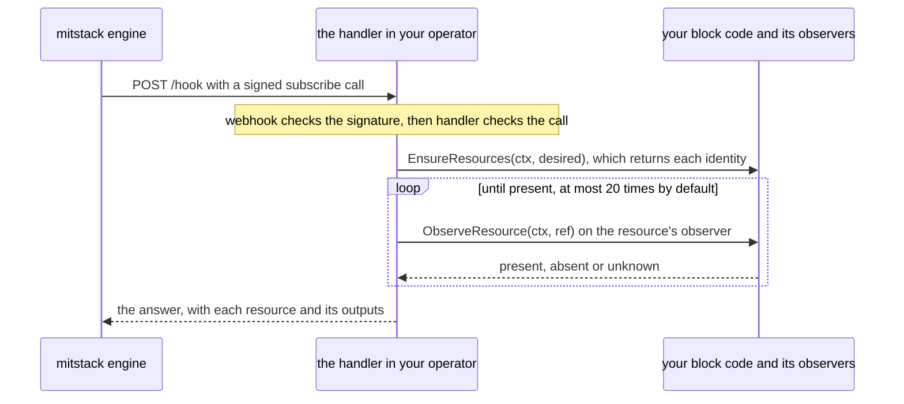

# block-kit

block-kit is the Go module you write a mitstack block's operator with. This
page, for a developer building a first block, explains what a block and its
operator are, follows one call into your code, names the packages to import
and the optional ones, and ends with a block to copy. Its commands name
v0.4.0, the first release under the name block-kit.

## What a block and its operator are

mitstack is a platform that runs managed services for apps. A block is one such
service, described by the `manifest.yaml` file in the block's repository. The
manifest names the block, its version and the resources it creates. A resource
is one object at a provider, such as a firewall in a Hetzner Cloud project.
Each resource has a resource type (the exact sort of object it is, written
`<capability>.<name>`, where the capability names the provider, as in
`hetzner.firewall`), and a name in the manifest, which is its type unless the
manifest gives another. Once created, a resource has an identity, the values
such as an id that find it at the provider, and outputs, the values such as an
address that other blocks of the app may read.

An app uses a block through a subscription, and the block marks everything it
creates with the subscription's id, as a tag or a label, so mitstack can always
find what a subscription owns. The engine, the part of mitstack that drives
every subscription, sends the block four lifecycle calls over HTTPS.
`subscribe` creates the resources, `upgrade` brings them to a new version of
the block, `validate` reports whether each one stands and changes nothing, and
`unsubscribe` deletes them. The operator is the program you write with this kit
to answer those calls, a small HTTP server shipped as a container image.

## How one lifecycle call reaches your code

Your block's code implements `handler.Resource`, an interface of two methods.
`Ensure` creates what is missing. `Delete` deletes, and returns any outputs the
answer should still carry once the resources are gone, usually none. Each
resource has an observer, whose one method,
`ObserveResource(ctx, ref)`, gets the resource's name, type and identity and
the call's `contract.Desired` in a `contract.ResourceRef`, and asks the
provider about it. It returns a `contract.Observation`: `contract.Present`,
`contract.Absent` or `contract.Unknown`, and the resource's outputs. The kit's
`observe` package has observers for common resource types, and you write one
for any other type. `handler.New` takes a `handler.Config` holding your code,
the observers, your manifest and the address of mitstack's public keys. It
returns the HTTP handler your operator serves, which answers calls on
`POST /hook`, the path your manifest's endpoint ends in:



1. The handler first runs the kit's `webhook` checks that mitstack signed the
   call, that it is under five minutes old and that it is not a replay. A call
   that fails one answers 401 with a refusal class and never reaches your
   code. When the platform's signing keys cannot be fetched, it answers 503.
2. The handler decodes the call and checks a token mitstack signs into it,
   which names the block and subscription the call is for, so a call cannot be
   replayed to another block. A mismatch answers 401 too. The handler hands
   your code the call as a `contract.Desired`: the subscription, its settings,
   the provider credentials it carries and the resources mitstack recorded.
3. On `subscribe` and `upgrade`, the handler calls your `EnsureResources`, the
   one method of the `handler.ResourceReporter` interface, which does the work
   of `Ensure` and also returns each identity. Write it, since an observer
   finds its resource by that identity. The handler checks whether your code
   has it and calls `Ensure` only for code without it. On `unsubscribe` it
   calls `Delete`, and on `validate` neither.
4. The handler then waits for the call to settle, which means it asks each
   resource's observer until the provider shows the state the call asked for,
   20 times at most by default, where unknown means the provider cannot tell
   yet. A `validate` asks each observer once.
5. The handler answers with each resource's state and outputs. A call that
   has not settled answers that it is still in progress, and the engine sends
   it again later or asks with `validate`, so `Ensure` and `Delete` must be
   safe to repeat.

## What a block imports

A block must import the four packages at the root of this repository,
`contract`, `handler`, `observe` and `webhook`, and its tests must import
`verify/kittest`: your code is written against their types, and blockverify,
the check every block must pass before its image ships, runs your tests'
kittest checks. Everything else is optional, in `helpers` when tied to no
provider and in `capabilities` per provider:

| Package | Who imports it | What it gives you |
|---|---|---|
| `contract` | Every block | The call's types, such as `contract.Desired` and `contract.Observation`, and the manifest parser |
| `handler` | Every block | `handler.New`, which serves the lifecycle calls over your code |
| `observe` | Every block | Observers for common resource types, such as `observe.HetznerFirewall`, and listers, which your tests use to find everything marked with a subscription's id |
| `webhook` | Every block | The signature checks the handler runs, and `webhook.LogBuffer`, which holds the recent log lines mitstack reads from your operator |
| `verify/kittest` | Every block's tests | The checks blockverify requires your tests to run |
| `helpers/safe` | A block that logs values from a call, or calls an API at an address a call supplies | Secret scrubbing for logs, and an allowlist of the hosts the operator trusts, so a call cannot redirect it |
| `helpers/events` | A block that reports its own progress during long work | Progress reports to mitstack while a long call runs |
| `helpers/credrefresh` | A block whose short-lived credential must outlive one call | A cache that renews a credential before it expires |
| `helpers/hostexec` | A block that runs a shell script on a server | One script run over AWS Systems Manager or SSH |
| `helpers/reach` | A block that serves an app at a URL | A probe that records whether the app answers |
| `capabilities/aws/cloudid` | A block whose resources live in AWS | Short-lived AWS credentials for the AWS account a call names |
| `capabilities/github/ghapi` | A block that calls the GitHub API | A GitHub REST client whose host the operator decides |
| `capabilities/github/gitops` | A block that deploys to Kubernetes through Argo CD | Commits the block's files to a GitOps repository and judges the deploy, with test fakes in `capabilities/github/gitops/gitopstest` |

## A minimal block to copy

[`examples/hetzner-firewall`](examples/hetzner-firewall) is a complete block
that keeps one empty Hetzner Cloud firewall for each subscription, the simplest
resource a provider offers for free. Every call carries the credentials of each
connection the block uses (a connection is an account the subscriber connected
at a provider, such as a Hetzner Cloud project), filed under the connection's
name, here `hetzner`. The manifest's `verbConnections` (a verb is a lifecycle
call) names the connections a `validate` and an `unsubscribe` need, so the
platform can leave the others out of those calls. The example names its Hetzner
connection for both, since the observer and `Delete` use it. [Writing the
manifest](docs/manifest.md) explains every key. The manifest, from
[`examples/hetzner-firewall/manifest.yaml`](examples/hetzner-firewall/manifest.yaml):

```yaml
apiVersion: mitstack/v1beta
type: block
metadata:
  id: hetzner-firewall
  name: Hetzner firewall
spec:
  version: 0.1.0
  description: Keeps one empty Hetzner Cloud firewall for each subscription.
  resources: [hetzner.firewall]
  lifecycle:
    endpoint: https://hetzner-firewall.example.com/hook
    operations: [subscribe, unsubscribe, upgrade, validate]
    contract: kit/v1
    verbConnections:
      validate: [hetzner]
      unsubscribe: [hetzner]
```

The block's code, from
[`examples/hetzner-firewall/block.go`](examples/hetzner-firewall/block.go):

```go
package main

import (
	"context"

	"github.com/mitstack-eu/block-kit/contract"
)

const firewallResource = "hetzner.firewall"

// block creates and deletes the subscription's firewall, and observe.HetznerFirewall reports whether it stands.
type block struct{ cloud *hetzner }

func (b block) EnsureResources(ctx context.Context, d contract.Desired) ([]contract.CreatedResource, error) {
	id, err := b.cloud.ensureFirewall(ctx, d)
	if err != nil {
		return nil, err
	}
	return []contract.CreatedResource{{Name: firewallResource, Type: firewallResource, Identity: map[string]string{"firewallId": id}}}, nil
}

func (b block) Delete(ctx context.Context, d contract.Desired) (map[string]string, error) {
	return nil, b.cloud.deleteFirewalls(ctx, d)
}

// Ensure completes handler.Resource, and the handler calls EnsureResources in its place.
func (b block) Ensure(ctx context.Context, d contract.Desired) error {
	_, err := b.EnsureResources(ctx, d)
	return err
}
```

`EnsureResources` reports the firewall under its name, its type
`hetzner.firewall`, with the identity `firewallId` that
`observe.HetznerFirewall` asks Hetzner about. The other files:

- `config.go` builds the `handler.Config`: `Resource` holds the block,
  `Observers` files `observe.HetznerFirewall` under the resource's name,
  `Manifest` and `Types` hold the manifest and the type snapshot, and `Logs` a
  log buffer. [Serving lifecycle calls](docs/handler.md) explains each field.
- `main.go` embeds `manifest.yaml` and `type-snapshot.json`, and sets the
  config's `JWKSURL` from `MITSTACK_JWKS_URL`, the address of the JSON Web Key
  Set holding mitstack's public keys, which the `webhook` checks verify
  signatures with: `https://api.mitstack.dev/.well-known/jwks.json` in
  production. It passes the config to `handler.New(cfg)` and serves the
  returned handler at the root of an `http.Server` on port 8080.
- `hetzner.go` makes the Hetzner Cloud calls and labels each firewall with the
  subscription's id.
- `type-snapshot.json` is the `hetzner.firewall` entry of mitstack's type
  catalogue, its list of every resource type and its outputs. The handler and
  `kittest.AssertBlock` read it, and you copy your own types' entries from the
  catalogue, as [Writing the manifest](docs/manifest.md) explains.
- `block_test.go` runs blockverify's three required tests against a fake
  Hetzner API: `TestDeclaredResources`, which calls `kittest.AssertBlock`, and
  tests named `TestUnsubscribeDeletes...` and `TestNoSecretLeak...`.

To start your own block, copy the folder into a new repository and delete the
`replace` line from its `go.mod`, which points the example at the kit beside
it, so that `go mod tidy` fetches block-kit v0.4.0 instead. Change the module
path, `metadata.id` and the endpoint, swap the firewall for your resource in
every file, and run your tests and blockverify from the copy:

```sh
go test ./...
go run github.com/mitstack-eu/block-kit/verify/blockverify@v0.4.0 --standalone .
```

blockverify runs only with `--standalone`, which checks the block in the
directory you name, here `.`, on its own. It runs seven suites, groups of
checks, and a passing block ends with `VERDICT: PASS — 7 suite(s)`.

## The rest of the repository

`verify` also holds `blockverify` and three packages no block imports.
`blockprov` and `provenance` sign a record of the repository, commit and CI
run that built a block's image, and `attest` checks the platform's signed
record that a block passed blockverify. Your block's CI calls the kit's
publish workflow, as [Running the block checks](docs/block-checks.md) shows,
and that workflow runs `blockprov` for you. `examples` holds the example,
`cmd` and `scripts` the kit's own commands, and `board` mitstack's
work-tracker tooling, a Go module no block uses. `docs` holds these pages:

| Page | What it covers |
|---|---|
| [Writing the manifest](docs/manifest.md) | Every manifest key, block ids, resource types and the type snapshot |
| [Serving lifecycle calls](docs/handler.md) | `handler.New`, the trust checks, each call, errors, retries and the answer |
| [Observing resources](docs/observe.md) | What an observer returns, the kit's observers, and the listers that find what a subscription holds |
| [Testing a block](docs/testing.md) | `kittest.AssertBlock` and the secret-leak and teardown checks |
| [Running the block checks](docs/block-checks.md) | What blockverify judges and where CI runs it |
| [The optional helpers](docs/helpers.md) | `helpers` and the AWS and GitHub capability packages |
| [Deploying through GitOps](docs/gitops.md) | The `gitops` package and Argo CD |
| [Maintaining the kit](docs/maintainers.md) | Releases, delivery records and the kit's own checks |

## Licence

block-kit is licensed under the [Business Source License 1.1](LICENSE). You
may read, copy and change the kit, and use it in production only to build,
run or operate what the mitstack platform manages. Each release, `v0.4.0` and
every later one, becomes Apache-2.0 four years after it is published.
