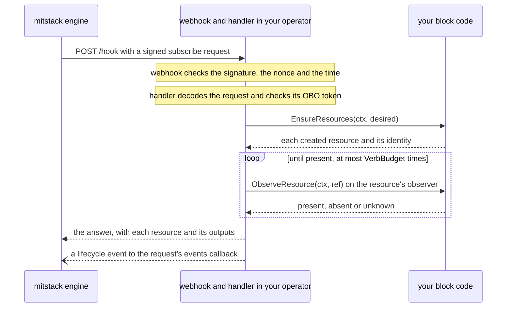

# block-kit

block-kit is the Go module you write a mitstack block's operator with. This
page is for a developer building a first block. It explains what a block and
its operator are, follows one lifecycle call into your code, names the
packages every block imports and the optional ones, and ends with a block to
copy. Its commands name v0.4.0, the kit's first release.

## What a block and its operator are

mitstack is a platform that runs managed services for apps. A block is one such
service, described by the `manifest.yaml` file in the block's repository. The
manifest names the block, its version and the resources it creates. A resource
is one object at a provider, such as a firewall in a Hetzner Cloud project.
Each resource has a resource type (the exact sort of object it is, written
`<capability>.<name>` as in `hetzner.firewall`).

An app uses a block through a subscription. The engine, the part of mitstack
that drives every subscription, sends the block four lifecycle calls over
HTTPS. `subscribe` creates the resources for a new subscription, `upgrade`
brings them to a new version of the block, `validate` reports whether each
resource stands and changes nothing, and `unsubscribe` deletes them. The
operator is the program you write with this kit to answer those calls, a small
HTTP server shipped as a container image.

## How one lifecycle call reaches your code

The engine signs every call with mitstack's private key and posts it to the
endpoint your manifest names. Inside your operator, the kit's `webhook`
package checks the call is genuine, and the `handler` package turns it into
calls on your code:



1. `webhook` fetches mitstack's public keys from the JWKS URL you configure
   and verifies the Ed25519 signature in the `X-Mitstack-Signature-Ed25519`
   header. It answers 401, before any of your code runs, to a bad signature,
   to a request created more than five minutes ago and to a reused nonce.
2. `handler` decodes the body into a `contract.Request` and checks its OBO
   token, a second signed token that must name your manifest's `metadata.id`
   and the request's org, app and subscription.
3. On `subscribe` and `upgrade`, `handler` calls your block's `Ensure`, which
   creates whatever is missing. When your block also has `EnsureResources`,
   as the example below does, `handler` calls that instead, since it also
   returns each resource's identity, such as its id at the provider.
4. `handler` then waits for the call to settle, which means it asks each
   resource's observer until the provider shows the state the call asked for.
   An observer is code, yours or the kit's, that asks the provider whether one
   resource stands.
5. `handler` answers with what it observed, and sends the engine an event
   saying whether the call completed, is still in progress or failed.

| Call | What `handler` calls on your code once the checks pass |
|---|---|
| `subscribe`, `upgrade` | `EnsureResources` or `Ensure`, then each resource's observer until it reports present |
| `unsubscribe` | `Delete`, then each resource's observer until it reports absent |
| `validate` | Each resource's observer, once |

A call whose resources do not settle within `VerbBudget` observations answers
that it is still pending, and the engine asks again later.

## What a block imports

The root of this repository holds the four packages every block imports.
Everything else is optional, and you add it when your block needs what it
does:

| Package | Who imports it | What it gives you |
|---|---|---|
| `contract` | Every block | The request and answer types, such as `contract.Desired` and `contract.Observation`, and the manifest parser |
| `handler` | Every block | `handler.New`, which serves the lifecycle calls over your code |
| `observe` | Every block | Observers and provider listers for common resource types, such as `observe.HetznerFirewall` |
| `webhook` | Every block | The signature checks `handler` runs, and the buffer behind the `/logs` route |
| `verify/kittest` | Every block's tests | The checks your tests must run to pass blockverify, the kit's conformance verdict |
| `helpers/safe` | A block that logs a request's values or calls a host a request names | Secret scrubbing for logs, and an allowlist that picks the API host |
| `helpers/events` | A block that reports its own progress or reads a platform route | Lifecycle events beyond the ones `handler` sends, and the platform's address |
| `helpers/credrefresh` | A block whose short-lived credential must outlive one call | A cache that renews a credential before it expires |
| `helpers/hostexec` | A block that runs a shell script on a server | One script run over AWS Systems Manager or SSH |
| `helpers/reach` | A block that serves an app at a URL | A probe that records whether the app answers |
| `capabilities/aws/cloudid` | A block whose resources live in AWS | Short-lived AWS credentials from the request's cloud identity |
| `capabilities/github/ghapi` | A block that calls the GitHub API | A GitHub REST client whose host the operator decides |
| `capabilities/github/gitops` | A block that deploys to Kubernetes through Argo CD | Commits the block's files to a GitOps repository and judges the deploy, with fakes in `gitopstest` |

## A minimal block to copy

[`examples/hetzner-firewall`](examples/hetzner-firewall) is a complete block
that keeps one empty Hetzner Cloud firewall for each subscription, the
simplest resource a provider offers for free. Its manifest declares that
resource and the connection whose secrets its `validate` and `unsubscribe`
calls need, from
[`examples/hetzner-firewall/manifest.yaml`](examples/hetzner-firewall/manifest.yaml):

```yaml
apiVersion: mitstack/v1beta
type: block
metadata:
  id: hetzner-firewall
  name: Hetzner firewall
spec:
  version: 0.1.0
  description: Keeps one empty Hetzner Cloud firewall for each subscription.
  resources: [hetzner.firewall]
  lifecycle:
    endpoint: https://operators.example.com/hetzner-firewall/hook
    operations: [subscribe, unsubscribe, upgrade, validate]
    contract: kit/v1
    verbConnections:
      validate: [hetzner]
      unsubscribe: [hetzner]
```

The block's code, from
[`examples/hetzner-firewall/block.go`](examples/hetzner-firewall/block.go):

```go
package main

import (
	"context"
	_ "embed"
	"fmt"

	"github.com/mitstack-eu/block-kit/contract"
	"github.com/mitstack-eu/block-kit/handler"
	"github.com/mitstack-eu/block-kit/observe"
	"github.com/mitstack-eu/block-kit/webhook"
)

const firewallResource = "hetzner.firewall"

//go:embed manifest.yaml
var manifest []byte

//go:embed type-snapshot.json
var typeSnapshot []byte

// block creates and deletes the subscription's firewall, and observe.HetznerFirewall reports whether it stands.
type block struct{ cloud *hetzner }

func (b block) EnsureResources(ctx context.Context, d contract.Desired) ([]contract.CreatedResource, error) {
	id, err := b.cloud.ensureFirewall(ctx, d)
	if err != nil {
		return nil, err
	}
	return []contract.CreatedResource{{Name: firewallResource, Type: firewallResource, Identity: map[string]string{"firewallId": id}}}, nil
}

func (b block) Delete(ctx context.Context, d contract.Desired) (map[string]string, error) {
	return nil, b.cloud.deleteFirewalls(ctx, d)
}

// Ensure and Observe complete handler.Resource, and the handler calls EnsureResources and the observer in their place.
func (b block) Ensure(ctx context.Context, d contract.Desired) error {
	_, err := b.EnsureResources(ctx, d)
	return err
}

func (b block) Observe(context.Context, contract.Desired) (contract.Observation, error) {
	return contract.Observation{State: contract.Unknown}, nil
}

func newConfig(cloud *hetzner, logs *webhook.LogBuffer) (handler.Config, error) {
	types, err := contract.ParseTypeSnapshot(typeSnapshot)
	if err != nil {
		return handler.Config{}, fmt.Errorf("reading type-snapshot.json: %w", err)
	}
	return handler.Config{
		Resource:  block{cloud: cloud},
		Observers: map[string]handler.Observer{firewallResource: observe.HetznerFirewall{API: cloud}},
		Manifest:  manifest,
		Types:     types,
		Logs:      logs,
	}, nil
}
```

[`main.go`](examples/hetzner-firewall/main.go) passes that config to
`handler.New` with the JWKS URL from `MITSTACK_JWKS_URL`, which is
`https://api.mitstack.dev/.well-known/jwks.json` in production, and serves the
handler on port 8080. `hetzner.go` makes the Hetzner Cloud calls, and
`type-snapshot.json` describes `hetzner.firewall` as mitstack's type catalogue
does. `block_test.go` runs the block against a fake Hetzner API in the three
tests blockverify requires.

To start your own block, copy the folder into a new repository, delete the
`replace` line from its `go.mod` and run `go mod tidy`. Change the module
path, `metadata.id` and `spec.lifecycle.endpoint`, replace the firewall with
your resource, and run your tests and the block checks from the copy:

```sh
go test ./...
go run github.com/mitstack-eu/block-kit/verify/blockverify@v0.4.0 --standalone .
```

A passing block ends with `VERDICT: PASS — 7 suite(s)`, and
[Running the block checks](docs/block-checks.md) explains each suite.

## What is in this repository

The packages in the table above sit at the paths it names. The other folders:

| Folder | What it holds |
|---|---|
| `verify` | Besides `kittest`, the `blockverify` command and the provenance tooling the publish workflow runs |
| `examples` | The example block above, which CI tests and checks on every change |
| `cmd` | `commentcheck`, which judges a change's comments, and `manifest-schema`, which prints the manifest's JSON Schema |
| `docs` | The reference pages listed below, and `scripts` holds the kit's release script |
| `board` | mitstack's own work-tracker tooling, a separate Go module that no block uses |

## Where to read more

| Page | What it covers |
|---|---|
| [Writing the manifest](docs/manifest.md) | Every manifest key, block ids, resource types and the type snapshot |
| [Serving lifecycle calls](docs/handler.md) | `handler.New`, the trust checks, each call, errors, retries and the answer |
| [Observing resources](docs/observe.md) | The kit's observers, and the listers that find what a subscription holds |
| [Testing a block](docs/testing.md) | `kittest.AssertBlock` and the secret-leak and teardown checks |
| [Running the block checks](docs/block-checks.md) | What blockverify judges and where CI runs it |
| [The optional helpers](docs/helpers.md) | `helpers` and the AWS and GitHub capability packages |
| [Deploying through GitOps](docs/gitops.md) | The `gitops` package and Argo CD |
| [Maintaining the kit](docs/maintainers.md) | Releases, delivery records and the kit's own checks |

## Licence

block-kit is licensed under the Business Source License 1.1, whose full text
is in [the LICENSE file](LICENSE). You may read, copy and change the kit, and
use it in production only to build, run or operate what the mitstack platform
manages. Each release becomes Apache-2.0 four years after it is published.

`v0.4.0` is block-kit's first release under this licence, and every later
block-kit release carries it too.
